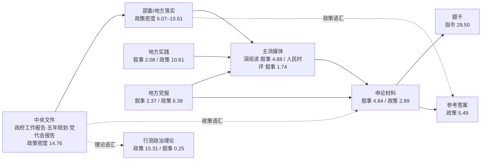

# 申论题目 / 官方政府文件 / 主流媒体报道：关系分析（v3，含地方党报）

数据来自三个仓库：`~/projects/Learn-to-Write`（语料 + 现成下载器）、`~/osint`（采集器 + 正文抽取）、
`~/Youknow/国考真题`（申论 2022–2026、行测政治理论 2018–2026）。
全部数字由 `analysis/` 下的脚本现算，输出在 `analysis/out/`。

---

## 0. 一句话结论

**申论不是"引用"某一篇，而是从一套党报语域里取材**——用「深阅读」的文体，讲「人民时评」的议题，
用「中央文件」的词汇，写成「参考答案」的政策语。

- **文体**：申论材料叙事密度 **4.84**，深阅读 **4.88**，人民时评 **1.74**，人民论坛 **1.52**；
- **取材**：72 个材料里 **68 个**能找到考试之前的语料近邻，中位领先 **11 个月**；
  45 个高置信近邻里 **40 个是地方党报**（不是人民日报）；
- **语汇**：政策短语命中率 申论 **0.361** vs 行测政治理论 **0.098**，理论短语反过来（0.139 vs 0.356）；
- **答案**：参考答案政策密度 5.49，贴近**部委发布**（6.07），不是中央文件（14.76）。

**一个否定结论**：地方党报 → 人民日报 → 申论 的"两步传播"**不成立**。22 个同时有两侧近邻的材料里，
地方党报更早的只有 7 个，中位差 −3 个月（人民日报略早）。地方党报之所以更近，是**文体同构**，
不是**时间在前**。

---

## 1. 数据底座

### 1.1 本轮补进来的东西

| 补什么 | 用什么工具 | 结果 |
|---|---|---|
| 人民日报评论 7 栏 2020-04 → 2026-11 | `tools/collect/download_renmin_commentary.py` | +2,786 篇 |
| 人民日报版面栏目 16 个 2023-01 → 2024-11 | `crawl_rmrb_columns.py`（复用 osint `extract_body`） | +2,144 篇 |
| 瞭望 10 栏 / 光明 3 栏 / 求是 3 栏 / 半月谈 / 经济日报 / 学习时报 | 各自的 `download_*.py` | +716 篇 |
| 中央文件：政府工作报告 2020–2023、十四五规划纲要、二十大报告 | `download_primary_sources.py`（追加 6 条已核 URL） | +6 篇 |
| **地方党报 4 家 2020-07 → 2024-12** | `crawl_local_papers.py`（自建，正文复用 osint `extract_body`） | **+11,489 篇** |
| 行测政治理论 2018–2026 | 本地 `_build/md` 解析 | 205 题 |
| 英文语料 | `build_index_west.py` | 6,833 篇（单独索引） |

### 1.2 地方党报：探源结论

先探了 42 家省级/副省级党报数字报（`out/local_papers_probe.csv`），**只有 6 家还在跑可读的方正老平台**：

| 报纸 | 省份 | 可回溯 | 版面入口 | 结果 |
|---|---|---|---|---|
| 河南日报 | 河南 | 2020-07 | `node_N.htm` + `content_NN_XXXXXX.htm` | 262 篇（评论/理论版非每日） |
| 青岛日报 | 山东 | 2020-07 | 同上 | 2,116 篇 |
| 太原日报 | 山西 | 2021-01 | 同上 | 3,596 篇 |
| 湖南日报 | 湖南 | 2021-01 | 图片版 `<Area href>`，只抓头版 | 6,155 篇 |
| 江西日报 | 江西 | 2024 起 | 同上 | 未采（窗口太短） |
| 南方/解放/北京/辽宁/长江日报 | — | 2020 | 页面是 Nuxt/SPA 壳，正文靠 JS | 放弃 |

**结构性障碍**：省级党报数字报在 2020 年前后大面积改版成 SPA/APP 或只保留近 2–3 年存档。
浙江、江苏、安徽、四川、湖北、陕西、贵州、福建 8 个高价值省份**全部**探不到 2020–2024 的文本存档
（四川日报是版面图片，新华日报/黑龙江日报是 JS 壳，其余 host 不可达）。这不是 URL 没猜对，是存档没了。

### 1.3 现在的规模

统一索引 **20,227 篇**（v1 3,300 → v2 8,738 → v3 20,227），时间覆盖 **2017-05 → 2026-11**：

| 层 | 篇数 | 主要来源 |
|---|---:|---|
| `A0` 中央文件 | 42 | 政府工作报告 2020–2026（7 份）、十四五规划纲要、二十大报告、三中全会决定、国务院文件 31 件 |
| `A1` 部委发布 | 788 | 发改委 49、商务部 43、统计局 39、能源局 35、证监会 30、网信办 27、工信部 27、央行 18… |
| `B` 主流媒体 | 7,246 | 人民日报 5,300、环球时报 456、光明日报 378、经济日报 235、瞭望 216、求是 205、半月谈 199、学习时报 113 |
| **`C1` 地方党报** | **11,489** | 湖南日报 6,155、太原日报 3,596、青岛日报 2,116、河南日报 262 |
| `C` 地方实践 | 472 | 地方党政领导活动（人民网地方领导资料库） |
| `D` 学术智库 | 178 | 爱思想 131、学术期刊 47 |

**仍缺**：人民日报数字报 2020-01 → 2022-12 被 nginx 403 拦截（已验证 2022-12-30 403、2023-01-02 200）。

---

## 2. 关系模型



### 2.1 语体指纹：六种文体，六套语汇

每千字标记词密度（叙事=他说/村民/走进/现场…；政策=坚持/推动/统筹/机制…；指令=请根据/拟写/概括/不超过…）：

| 语料 | 篇 | 叙事 | 政策 | 指令 |
|---|---:|---:|---:|---:|
| **申论材料** | 72 | **4.84** | 2.89 | 2.56 |
| 人民日报·**深阅读** | 242 | **4.88** | 3.78 | 0.57 |
| 人民日报·现场评论 | 199 | 3.75 | 6.34 | 0.30 |
| **地方党报 C1** | 11,489 | 2.37 | 6.39 | 0.50 |
| 地方领导报道 C | 472 | 2.08 | 10.61 | 0.34 |
| 人民日报·评论员观察 | 302 | 1.76 | 11.94 | 0.52 |
| 人民日报·人民时评 | 1,122 | 1.74 | 7.79 | 0.49 |
| 人民日报·纵横 | 552 | 1.53 | 9.78 | 0.69 |
| 人民日报·人民论坛 | 1,348 | 1.52 | 5.71 | 0.32 |
| 人民日报·人民观点 | 181 | 0.81 | 13.29 | 0.78 |
| **中央文件 A0** | 42 | 1.10 | **14.76** | 0.34 |
| 部委发布 A1 | 788 | 1.82 | 6.07 | 0.55 |
| **申论题干** | 75 | 0.59 | 9.52 | **29.50** |
| **行测政治理论** | 205 | 0.25 | **15.31** | 0.86 |
| **参考答案** | 15 | 2.14 | **5.49** | 4.75 |

四件事：
1. **申论材料 = 深阅读**（4.84 vs 4.88），13 个语料组里唯一重合的一对；
2. **人民论坛（1.52）和申论材料差 3.2 倍**——同一份报纸，议论体和叙事体是两种东西；
3. **地方党报（2.37 / 6.39）** 是"政策语 + 一点案例"的中间态，比人民日报评论政策更重、比地方领导报道叙事更多；
4. **行测政治理论**政策密度最高（15.31，超过中央文件 14.76），叙事几乎为零（0.25）；
5. **参考答案**（5.49）贴近部委发布（6.07），离中央文件（14.76）很远——写的是"部门落实语"。

### 2.2 文体近邻：深阅读 3.48×，人民论坛 0.06×

72 个材料逐段做字符 bigram TF-IDF，与 20,215 篇语料比（top-1 近邻的富集）：

| 栏目 | 语料占比 | 材料 top-1 占比 | 富集 |
|---|---:|---:|---:|
| **深阅读** | 1.2% | 4.2% | **3.48×** |
| 评论员观察 | 1.5% | 4.2% | 2.79× |
| 纵横 | 2.7% | 4.2% | 1.53× |
| 人民时评 | 5.6% | 6.9% | 1.25× |
| **地方党报** | 56.8% | 63.9% | 1.12× |
| 其他媒体 | 18.2% | 11.1% | 0.61× |

> v2（无地方党报）时深阅读是 **7.01×**；加入 11,489 篇地方党报后分母翻倍，降到 3.48×。
> 单篇命中率仍然是所有媒体栏目里最高的。

长度控制：深阅读平均 2,633 字，短于语料均值；人民论坛只有 1,336 字却几乎不命中。
所以这不是篇幅效应，是**文体效应**。

### 2.3 层间分工：谁谈什么

各层文档中提及该主题的比例：

| 主题 | 中央文件 | 部委发布 | 主流媒体 | 地方党报 | 地方实践 | 学术智库 |
|---|---:|---:|---:|---:|---:|---:|
| 医疗卫生 | 0.55 | 0.24 | 0.21 | **0.30** | 0.21 | 0.37 |
| 人工智能与数据 | 0.36 | 0.28 | 0.19 | 0.15 | 0.20 | 0.26 |
| 消费与内需 | 0.36 | **0.34** | 0.18 | 0.15 | 0.13 | 0.15 |
| 科技创新 | 0.45 | 0.21 | 0.17 | 0.10 | 0.25 | 0.16 |
| 制造业转型 | 0.31 | 0.24 | 0.17 | 0.16 | 0.21 | 0.12 |
| 文化自信 | 0.33 | 0.06 | 0.17 | 0.14 | 0.13 | **0.38** |
| 干部作风 | 0.19 | 0.06 | 0.11 | 0.09 | **0.23** | 0.19 |
| 基层治理 | 0.36 | 0.02 | 0.08 | 0.07 | 0.07 | 0.12 |
| 安全应急 | 0.57 | 0.10 | 0.06 | 0.05 | **0.29** | 0.11 |
| 城市治理 | 0.24 | 0.06 | 0.05 | 0.04 | 0.11 | 0.05 |

地方党报的超配项：**医疗卫生 0.30**（唯一显著高于其他层的主题）、文旅非遗 0.16、交通物流 0.17、就业 0.17。
它不像人民日报那样超配"基层治理/文化自信/干部作风"，而是平均地覆盖"地方落实"的各个口。

### 2.4 语汇传递：150 个政策短语

20 个出现在申论材料里（下表列 11 个主要的，完整见 `out/phrases.csv`）：

| 短语 | 语料篇数 | 首次出现 | 中央 | 部委 | 媒体 | 地方党报 | 真题 |
|---|---:|---|---:|---:|---:|---:|---|
| 乡村振兴 | 1,187 | 2020-02 | 12 | 17 | 380 | 748 | 5 场 |
| 未来产业 | 405 | 2020-04 | 6 | 37 | 187 | 147 | 2 场（2025行政材1、2026副省材3） |
| 高标准农田 | 188 | 2020-05 | 8 | 5 | 74 | 94 | 2 场（2024副省材4/5） |
| 生态产品价值实现 | 74 | 2020-11 | 3 | 2 | 43 | 25 | 2 场（2023地市材1、2023行政材1） |
| 碳汇 | 78 | 2021-03 | 4 | 1 | 35 | 37 | 2 场（2023地市材1、2023行政材1） |
| 单项冠军 | 65 | 2021-03 | 1 | 3 | 20 | 40 | 2 场（2024地市材2、2024行政材2） |
| 新质生产力 | 954 | 2023-11 | 8 | 75 | 543 | 254 | 1 场（2025行政材1） |
| 共同富裕 | 643 | 2020-03 | 7 | 7 | 292 | 293 | 1 场（2023地市材4） |
| 新就业形态 | 145 | 2020-06 | 8 | 5 | 64 | 63 | 1 场（2025行政材2） |
| 一网通办 | 106 | 2021-01 | 2 | 3 | 42 | 58 | 1 场（2022行政材1） |
| 多式联运 | 83 | 2020-06 | 3 | 9 | 13 | 55 | 1 场（2026地市材1） |

> 「语料篇数」是各层之和；地方党报一列单列，因为它现在是最大的一层。

**热度极高但 2022–2026 从未进题的**（2027 观察名单）：

| 短语 | 语料篇数 | 中央 | 部委 | 媒体 | 地方党报 |
|---|---:|---:|---:|---:|---:|
| 十五五 | 788 | 3 | 173 | 488 | 99 |
| 正确政绩观 | 348 | 3 | 37 | 197 | **100** |
| 现代化产业体系 | 290 | 7 | 28 | 220 | 32 |
| 绿色转型 | 263 | 10 | 28 | 204 | 12 |
| 全国统一大市场 | 218 | 11 | 13 | 190 | 3 |
| 城市更新 | 171 | 10 | 26 | 111 | 22 |
| 服务消费 | 115 | 10 | 25 | 77 | 3 |
| 人工智能+ | 113 | 4 | 29 | 64 | 9 |
| 低空经济 | 99 | 5 | 14 | 65 | 14 |
| 投资于人 | 85 | 4 | 7 | 68 | 5 |

**"谁先说"这个语料答不了**：中央文件 42 篇 vs 媒体 7,246 篇，密度差 170 倍。
现在算出来 79/112 的短语媒体先出现，只能当**上界**读。

---

## 3. 时间关系：材料 ← 党报，中位 11 个月

72 个材料里，**68 个**能找到考试之前就存在的语料近邻；其中 **45 个**相似度 ≥0.15：

| 指标 | 值 |
|---|---|
| 领先月数中位 | **11 个月** |
| 四分位 | 6 – 19 个月 |
| 高置信近邻出处 | **地方党报 40 / 45** |

高置信样本（`out/best_pre.csv`）：

| 材料 | 语料近邻 | 领先 |
|---|---|---:|
| 2024 行政 材3（非遗法实施成效） | 太原日报 2023-10-23《激活非遗力量 让太原故事可触可感》 | 1 月 |
| 2025 副省 材1（三条黄河） | 太原日报 2023-06-12《数字孪生为黄河防汛装上"智慧大脑"》 | 18 月 |
| 2025 行政 材2（工会服务） | 湖南日报 2024-06-02《湖南省实施〈工会法〉办法》 | 6 月 |
| 2024 副省 材4（高标准农田） | 太原日报 2023-02-09《高标准农田里的"丰收密码"》 | 9 月 |
| 2026 副省 材4（家庭式养老） | 青岛日报 2021-12-25《加快完善养老服务体系》 | 47 月 |
| 2022 行政 材3（减税降费） | 青岛日报 2020-10-31《落实减税降费 助推经济发展》 | 13 月 |
| 2023 地市 材2 / 2023 行政 材4（知识产权） | 湖南日报 2022-04-18《企业上市如何跨越知识产权门槛》 | 9 月 |
| 2025 地市 材4（元科普） | 人民日报 2024-02-20《让科学普及与科技创新"两翼齐飞（人民时评）》 | 10 月 |

### 3.1 否定结论：没有"两步传播"

如果"地方党报 → 人民日报 → 申论"成立，同一材料的两个近邻里地方党报应该更早。事实是：

| 指标 | 值 |
|---|---|
| 两侧都有前置近邻的材料 | 22 |
| 地方党报更早 | **7 / 22** |
| 领先差（地方 − 人民）中位 | **−3 个月**（人民日报略早） |
| 四分位 | −10 – +3 个月 |

所以地方党报之所以更近，是**文体同构**（同为"公文语+案例"），不是**时间在前**。
人民日报和党报在同一个议题上基本同步，申论从这套语域里取材，不挑来源。

**实体层面仍然不重合**：材料里的专名（家庭式养老、元科普、共享村落、林票、城市用光、暗夜星空）
在语料中命中 0–10 篇。申论材料是**匿名化改写**（H市、C市、段主任）。

一个反向证据：2026 副省 材1 考"城市用光/光污染"管理，语料里"光污染"只有 3 篇，全是 2026-07
爱思想关于《生态环境法典》的法学论文——**考试早于法典**。申论命题跟的是**政策议程前端**
（立法草案、试点、地方创新），不是已落地的文件。

---

## 4. 三个考试面的分工：申论 / 政治理论 / 文件

行测「政治理论」2018–2026 共 **205 题**（2025 年起独立成模块：63 题；2026：60 题）。

| 语汇类型 | 行测政治理论 | 申论材料 | 中央文件 | 主流媒体 |
|---|---:|---:|---:|---:|
| **理论语汇**（中国式现代化、全过程人民民主、自我革命…43 个） | **0.356** | 0.139 | 0.643 | 0.561 |
| **政策语汇**（新质生产力、未来产业、林票…150 个） | 0.098 | **0.361** | 0.643 | 0.421 |

单个词：

| 短语 | 政治理论 | 申论 | 中央文件 |
|---|---:|---:|---:|
| 中国式现代化 | 21 | **0** | 6 |
| 高质量发展 | 21 | 6 | 17 |
| 全面深化改革 | 9 | **0** | 3 |
| 以人民为中心 | 5 | **0** | 6 |
| 全面从严治党 | 5 | **0** | 3 |
| 依法治国 | 4 | **0** | 2 |
| 全过程人民民主 | 3 | **0** | 2 |

**申论几乎从不直接考理论表述**：43 个理论语汇里，**38 个**在 72 个材料中出现次数为 0。
政治理论反过来：150 个政策语汇里只有 **9 个**出现过。

三条线的分工：
- **中央文件**同时供给两套语汇（各 0.643）；
- **行测政治理论**只取理论那一套（0.356 / 0.098），考"原文复述 + 判断"；
- **申论**只取政策那一套（0.139 / 0.361），考"案例 + 对策"。

---

## 5. 2027 届（笔试约在 2026 年 11 月底）候选

按"2026-04→10 语料热度 × 距上次出题年数"排序（`out/candidates_2027.csv`）：

| 主题 | 语料占比 | 政策 | 媒体 | 地方 | 已考年份 | 判断 |
|---|---:|---:|---:|---:|---|---|
| 人工智能与数据 | 0.243 | 213 | 303 | 90 | 2022/2023/2025 | 热度第一，2025 只做材料未做主题 |
| 医疗卫生 | 0.230 | 176 | 282 | 95 | 全 5 年 | 常青，需换切口 |
| 科技创新 | 0.200 | 156 | 237 | 115 | 2022/2023/2025 | 中试/概念验证/耐心资本未用 |
| 消费与内需 | 0.212 | 252 | 234 | 58 | 全 5 年 | 部委超配，服务消费未深挖 |
| 制造业转型 | 0.200 | 185 | 230 | 99 | 全 5 年 | 老字号 2026 已用 |
| **文化自信** | 0.148 | 44 | 232 | 56 | 2022/2023/2024 | **两年未考**，媒体超配 2.8× |
| 就业与青年 | 0.172 | 122 | 234 | 56 | 2023–2026 | 新就业形态已用 |
| 人才 | 0.169 | 107 | 208 | 98 | 全 5 年 | 常青 |
| **干部作风** | 0.121 | 42 | 142 | **107** | 仅 2022 | **四年未考**，政绩观 348 篇、地方超配 3.9× |
| 能源电力 | 0.143 | 170 | 138 | 62 | 2023–2026 | 新型能源体系/虚拟电厂未用 |
| 对外开放 | 0.127 | 142 | 127 | 53 | 2022/2024/2026 | 制度型开放未做主题 |

三个缺口：**干部作风（正确政绩观）**、**文化自信**、**人工智能+ 的治理侧**。

---

## 6. 局限

1. **地方党报只覆盖 4 家，且偏中西部**（河南、山东青岛、山西太原、湖南）。浙江、江苏、安徽、四川、
   湖北、陕西、贵州、福建 8 个高价值省份的数字报 2020–2024 存档已不可读（SPA/APP/图片版）。
   这是**存档消失**，不是 URL 没猜对。要补只能走 CNKI/慧科等付费库，或 Wayback。
2. **人民日报 2020–2022 数字报 403**，深阅读只能从 2023-01 起。
3. **"谁先说"不可识别**：中央文件 42 篇 vs 媒体 7,246 篇，密度差 170 倍。
4. **主题分类是手写的 30 类关键词表**，"提及即算"，会高估常青主题。
5. **月度热度不可靠**：语料来源构成逐月变化，月度波动方向可信、幅度不可信。
6. **英文语料 6,833 篇只建了索引**，未参与匹配，且全部是 2025-08 → 2026-10。
7. **地方党报的 11,489 篇里，湖南日报 6,155 篇是头版**（版面导航是 JS，只能抓 node_1），
   版面结构与其他三家不可比。

---

## 7. 复现

```bash
cd ~/Youknow/analysis
python3 build_index.py          # 三仓库中文 → out/index.jsonl（20,227 篇）
python3 build_index_west.py     # 英文 → out/index_west.jsonl（6,833 篇）
python3 relate.py               # TF-IDF 近邻 + 主题矩阵 + 短语 → out/*.csv
python3 dynamics.py             # 短语生命周期 + 语体指纹 + 2027 候选
python3 poltheory.py            # 行测政治理论 205 题
python3 probe_local_papers.py   # 42 家党报数字报探源
```

回填（一次性，已跑完）：

```bash
cd ~/projects/Learn-to-Write
.venv/bin/python -m tools.collect.download_renmin_commentary renminshiping renminluntan pinglunyuan \
    shelun renzhongping renping zhongyin --start-date 2020-01-01 --index-pages 45 --delay 0.3
.venv/bin/python -m tools.collect.download_liaowang_commentary sp2 dyxx zglzjs szcl rgc sz zcjm rdjx tbbd lwft --start-date 2020-01-01
.venv/bin/python -m tools.collect.download_guangming_commentary lilun pinglun wenhua --start-date 2020-01-01
.venv/bin/python -m tools.collect.download_qiushi_theory qswp shelunpinglun liwenxuan --start-date 2020-01-01
.venv/bin/python -m tools.collect.download_banyuetan_articles --all-prefixes --start-date 2020-01-01
.venv/bin/python -m tools.collect.download_jingjiwang_commentary ent --start-date 2020-01-01
.venv/bin/python -m tools.collect.download_studytimes_commentary llwp llsd sxll whjy --start-date 2020-01-01
.venv/bin/python -m tools.collect.download_primary_sources        # 含新增的 6 份中央文件
/home/fires/osint/.venv/bin/python ~/Youknow/analysis/crawl_rmrb_columns.py 2023-01-01 2024-11-30
/home/fires/osint/.venv/bin/python ~/Youknow/analysis/crawl_local_papers.py 2020-07-01 2024-12-31 all
```

> `download_*.py` 必须用 `python -m tools.collect.xxx` 调用：直接跑脚本会让
> `tools/collect/http.py` 遮蔽标准库 `http`，报 `No module named 'http.client'`。

产物：

| 文件 | 内容 |
|---|---|
| `out/index.jsonl` / `index_west.jsonl` | 统一文档索引 |
| `out/matches.csv` | 72 材料 × top-12 近邻（含领先月数） |
| `out/best_pre.csv` | 每个材料的最佳**前置**近邻 |
| `out/local_papers_probe.csv` | 42 家党报数字报探源结果 |
| `out/exam_topics.csv` | 真题材料 × 主题 |
| `out/topic_heat.csv` / `topic_quarter.csv` | 语料主题热度（月/季 × 层） |
| `out/phrases.csv` / `phrase_lifecycle.csv` | 150 个政策短语的分布与首发层 |
| `out/poltheory_phrases.csv` | 政治理论 205 题的政策短语命中 |
| `out/register.csv` | 语体指纹 |
| `out/candidates_2027.csv` | 2027 候选主题排序 |
