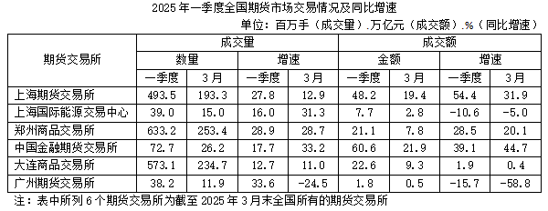

# 资料分析与数值计算：题型、速算条件与真题补充

研究日期：2026-11-16。主样本为2022—2026年国考副省级、地市级10卷；研究所用仓库版本为 `64a9b2472e706cd0840ab120f767d2baa997d502`。

本篇把“数值计算”覆盖为基础运算、资料分析列式、比较与速算。数量关系中的整数约束、计数与应用题模型另见[数量关系](01-数量关系.md)。已有[资料分析九课教学规范](../行测/资料分析专项/学习计划与教学规范.md)继续作为教学基线，本篇提供资料补充，不另设课程、测试或个人进度。

## 一、研究依据与结论

已核读10卷资料部分的题干，结合材料和解析重点复算2026年的混合增长、基期、累计与平均问题，并实际查看期货交易表原图。主目录资料节原有203个题位，其中3个属于错放的数量题；排除后为200个资料分析题位，按同年qid去重为165道。题位与独立试题数不同，具体错放记录见[来源与核验](来源与核验.md)。没有声称所有165道都经过独立重解或全部图表都经过图像核验。

原有教辅的统计概念、增长、比重、平均数和常见速算法基本齐全。已有九课规范还明确要求先讲术语、按选项控制精度、避免用现期量直接加权混合增长率。因此，本次补充的重点是把这些要求落实为可核算的例题、误差界限和方法选择，而非重新宣布这些原则。

2026年的外部考后分析也提到了混合增长、单位转换、数据与图表匹配；这些内容可与仓库题目相互核对。该文把部分混合题概括成“都需要十字交叉”，本研究不采用这一唯一解法断言：从基期量还原后直接计算，同样有效。[金标尺2026资料分析考后分析](https://m.jinbiaochi.com/qggwy/news_833197.html)

## 二、用同一个量率模型连接主要题型

对同一指标、相同统计范围的两个时期，记现期量为 \(A\)、基期量为 \(B\)、增长量为 \(\Delta\)、增长率为 \(r\)。通常要求 \(B>0\)：

\[
\Delta=A-B,\qquad r=\frac{A-B}{B},\qquad A=B(1+r).
\]

同比、环比决定选择哪个时期作基期；它们不另创造一套运算法则。累计值与当期值、全年与单月的统计区间必须先对齐。

以下涉及除以 \(1+r\) 的公式要求 \(1+r>0\)；下降100%的情形须回到原始量之间的关系处理，不能用现期0除以0还原基期。年均增长公式中的间隔数 \(n\) 为正整数。

| 主要题型 | 识别与核心关系 | 难点与快速入口 |
|---|---|---|
| 查找、求和、差额、排序、计数 | 先确定对象、时间、指标、单位和口径 | 一问是否只需比较或数符合条件的项；同分母可先合并分子，不必分别求百分比 |
| 基期量、现期量 | \(B=A/(1+r)\)，\(A=B(1+r)\) | 增长与下降的分母不同；先排数量级，再选截位或特征分数 |
| 增长量、增长率 | \(\Delta=Ar/(1+r)\)，\(r=\Delta/B\) | 增长率的分母是基期；比较增长量不能无条件只比 \(Ar\) |
| 间隔增长 | \(r_{12}=r_1+r_2+r_1r_2\) | 两个连续时期的增长率复合；与不同部分合成整体的“混合增长”分开命名 |
| 年均增长量、年均增长率 | \((A-B)/n\)；\((A/B)^{1/n}-1\) | \(n\) 是实际增长间隔数；不能把逐年增长率算术平均当复合年均增速 |
| 混合增长 | \(r=\sum B_i r_i/\sum B_i\)，\(B_i\) 为各部分基期量 | 总量可拆分且口径一致；先用区间和基期权重排除，再决定是否精算 |
| 现期、基期比重或平均数 | 现期比值 \(R=P/Q\)，两指标增速为 \(p,q\) 时，基期比值 \(R_0=R(1+q)/(1+p)\) | 比重与平均数共享比值代数，但统计含义、单位不同；分子分母不能颠倒 |
| 比值增速、比重变化 | 比值增速 \((p-q)/(1+q)\)；比重差 \(R(p-q)/(1+p)\) | 前者是相对增幅，后者是两个比例之差；比重差乘100才得到百分点数 |
| 倍数、翻番 | “是几倍”为 \(A/B\)；“增长几倍”为 \(A/B-1\)；翻 \(n\) 番为 \(2^n\) 倍 | 先区分结果与增量，不把“翻两番”理解为两倍 |
| 贡献率、拉动增长 | 贡献率为部分增长量/整体增长量；拉动增速为部分增长量/整体基期量 | 分母不同；不能用部分现期占比代替增长贡献 |
| 综合判断、图表匹配 | 每个选项独立确定任务，再复用已算结果 | 可先核符号、排名、总和、极值与明显量级；柱状图匹配不必计算每根柱的精确值 |

比值公式默认涉及的分母为正，增长因子 \(1+p,1+q\) 为正。只判断比重或平均数升降时，比较 \(p\) 与 \(q\) 即可；真正问变化多少时，才需要完整列式。

## 三、速算应按使用条件组织

### 1. 先消除运算，再决定近似

先约共同因子、合并同分母、移项比较，通常比直接算小数更稳。例如：

- 判断3月是否超过一季度月均值，比较 \(3M>Q\)，无需先算 \(Q/3\)。
- 同一总体中两个部分占比相差多少，直接算 \((P_1-P_2)/Q\)。
- 比较两个正分数，分子更大且分母更小者必然更大；不能直接判断时，可交叉乘或统一到方便的基准。
- 同样跨越 \(n\) 个时期的正值年均增速，比较末期/初期的比值即可，不必都开 \(n\) 次方。

这些变形本身精确；它们与随后采用的舍入近似要分别说明。

### 2. 凑整、尾数与有效数字

凑整可以写为“整值运算＋差额修正”，如乘以99转成乘100再减一次。加减法的尾数判别要求单位、位数对齐，而且原始数字足够精确；经过截位、除法或来源本身的四舍五入后，不能盲用末位锁定答案。

截位直除和有效数字乘法的精度由选项间距及误差共同决定。保留两位、三位是可选手段，不是固定规则。若近似结果贴近两个候选项的分界，应保留更多位或用上下界验证。乘法“一进一舍”也不保证两处误差正好抵消。

若要选最接近的数值，在通常的绝对差比较下，相邻两个候选值的中点才是判断分界。只找一个任意介于选项之间的数，未必足以判最近项。

### 3. 百化分与增长量简算

常用分数可帮助识别数值结构，例如 \(1/8=12.5\%\)、\(1/9\approx11.11\%\)、\(1/12\approx8.33\%\)。分清精确等式和近似替代后再使用。

若增长率恰为 \(r=1/n\)，则：

\[
\Delta=\frac{A/n}{1+1/n}=\frac{A}{n+1}.
\]

若下降幅度恰为 \(1/n\)，\(n>1\)，下降量的绝对值则为 \(A/(n-1)\)。增长与下降不能共用同一个分母。

当增长率只是接近 \(1/n\) 时，这两个结果也只是近似；选项很近时应修正或回到完整式子。教辅中的分数化方法可以保留，需显式补上这个判断。[中公四类列式速算原文](https://www.offcn.com/szyf/2016/0719/10273.html)，[仓库文字版](../教辅/行测/资料分析速算/offcn-资料分析四类列式速算.txt)

### 4. 把误差写成可判定的量

例如将基期量 \(A/(1+r)\) 近似为 \(A(1-r)\)，相对于精确基期量的误差为：

\[
\frac{A(1-r)-A/(1+r)}{A/(1+r)}=-r^2.
\]

因此 \(|r|=5\%\) 时，该近似相对低估0.25%。这只给出了误差大小；若相邻选项比这个量级还近，仍可能选错。不存在适用于所有试题的“允许5%误差”统一标准。

对正数相除，还可用区间检验。若已知 \(x\in[x_-,x_+]\)、\(y\in[y_-,y_+]\) 且 \(y_->0\)，则：

\[
\frac{x_-}{y_+}\le\frac{x}{y}\le\frac{x_+}{y_-}.
\]

整个区间都落在同一候选项的判定范围内，才有明确的舍入保障。并非每题都要写区间，但遇到相近选项应能说明粗算为何足够。

### 5. 比较、差分与十字交叉

分数差分法应先核查分子、分母的方向和正负。对 \(a>c>0\)、\(b>d>0\)，比较 \(a/b\) 与 \(c/d\)，可以转为比较 \((a-c)/(b-d)\) 与 \(c/d\)，两次比较的大小方向一致。这是由交叉乘的同一个不等式 \(ad>bc\) 得来。差值更复杂时没有必要强用。

两部分混合增长率可用十字交叉或线段表示，但对应的是**基期量之比**。对于 \(r_1<r<r_2\)：

\[
\frac{B_1}{B_2}=\frac{r_2-r}{r-r_1}.
\]

两部分基期量均为正时，总增速在两者之间，并更接近基期量较大部分的增速。三部分以上仍可用加权平均界，但不能机械扩展“离哪一个最近”的二分口诀。

## 四、近年真题把哪些限制条件放在一起

本节保留研究用的已解例题。它们含2025—2026答案；后续选择未见过的阶段整组时，应按实际接触情况避开已完整讲解题。这里不记录任何个人完成状态。

### 例1：2026期货市场——比较月均值可以完全免除法

题源：[2026副省卷](../行测/2026国考行测（副省级）.md)，主目录第118题，qid19526444。

问3月成交量超过一季度月均成交量的交易所个数。逐行核对 \(3M>Q\)：上海579.9>493.5，能源45>39，郑州760.2>633.2，金融78.6>72.7，大连704.1>573.1，广州35.7<38.2，故为5个。

普通法要做六次除以3；替代方法把任务改写为整数倍比较，结果精确。

### 例2：2026期货市场——季度同比减去单月同比

同一副省卷主目录第117题，qid19526443。已知上海一季度成交额48.2万亿元、同比增长54.4%；3月19.4万亿元、同比增长31.9%，求1—2月同比增速区间。

应先还原上一年同一时期的两个量，再相减：

\[
r_{1-2}=\frac{48.2-19.4}{48.2/1.544-19.4/1.319}-1
\approx74.44\%.
\]

结果落在65%—85%区间。季度由1—2月与3月两部分组成，也能用混合增长思想求解；但现期季度额和单月额不能直接当精确的基期权重。

本题库内解析用现期量近似权重，所得约69.56%，仍在同一区间，因此可以解释其选项为何正确。研究时应把“近似在这组区间选项下足够”与“加权关系精确成立”分开，不应把整个解析一概判为错误。

### 例3：2026进出口——混合增长率要先分清权重

题源：[2026副省卷](../行测/2026国考行测（副省级）.md)主目录第132题、[地市卷](../行测/2026国考行测（地市级）.md)第127题，共同qid19526366。

现期出口8664.6亿元、增速4.3%；进口5565.5亿元、增速12.8%。总增速可精确列为：

\[
r=\frac{8664.6+5565.5}{8664.6/1.043+5565.5/1.128}-1
\approx7.467\%,
\]

选择约7.5%。先利用总增速介于4.3%和12.8%之间、出口基期量较大等信息，可减少候选项；如剩余选项仍需区分，就继续计算。不能将两增速算术平均，也不能把现期权重法无说明地写成恒等式。

### 例4：2026月均进口——基期、区间差与平均同时出现

同一材料，副省主目录第134题、地市第129题，qid19526370。2024全年进口5565.5亿元、同比增长12.8%；12月进口512.7亿元、同比增长18.1%。求2023年1—11月月均进口值：

\[
\frac{5565.5/1.128-512.7/1.181}{11}
\approx409.08\text{亿元}.
\]

要先把全年与12月分别还原到2023年，再求差、除以11。先在2024年求差后随意套一个增长率，会把不同口径混在一起。

### 例5：2026绿证——累计量转成年度量

题源：2026两卷共同qid19526367。问年度核发量之比，材料给的是历年累计值。计算应为：

\[
\frac{22075-5954}{5954-3893}\approx7.82.
\]

不能直接用两个累计值相除。另一问qid19526371比较同一总体中的风电与太阳能占比，用 \((19.07-8.03)/46.77\) 即可，约差23.6个百分点；不必分别计算两个占比再相减。

### 另外需要保留的变式

- 2025地市qid19283942：上座率提高5个百分点、座位数不变时，新观众量按 \((p+0.05)/p\) 倍变化，不能直接把原观众量乘1.05。
- 2024副省qid5893722：增长贡献率与现期比重使用不同的分子分母。
- 2024地市qid5894969、2025副省qid19283961：固定增加量、首次超过某值的整数边界，连接了资料分析与数量关系中的等差应用。
- 2026的图表匹配题：先用增长或下降的符号、相对高低、总量约束排除；图形中的量轴、图例、时期仍需实际核对。

这些题目说明，题型目录可以保持稳定，解题过程则需要把口径、时期、比值、整数边界联合起来。

## 五、一条必须纠正的增长量口诀

[深圳资料分析讲义文字版](../教辅/行测/资料分析速算/huatu-深圳公务员笔试资料分析.txt)把“现期量与增长率一大一小”时比较乘积的规则写得过于绝对。对现期量 \(A\) 与增长率 \(r\)，真正的增长量是 \(Ar/(1+r)\)。

整理者构造的反例（不是真题）：

| 对象 | 现期量 | 增长率 | 现期量×增长率 | 实际增长量 |
|---|---:|---:|---:|---:|
| 甲 | 100 | 20% | 20 | 100×20%/1.2≈16.67 |
| 乙 | 195 | 10% | 19.5 | 195×10%/1.1≈17.73 |

乘积甲大，实际增长量却乙大。所以该乘积只能作为有待验证的近似比较，不能取代分母。正增长时，若现期量和增长率均更大，则增长量更大；一大一小时应回到完整表达式，或用能保证方向的上下界。

同样，网上新文章也可能把“某种粗算在例题里选对”误写成普遍误差许可。更新时采用可复核的计算关系，不把发布日期当正确性的证明。

## 六、怎样补入已有九课

| 已有课次 | 原规范已包含 | 本次可以接入的具体补充 |
|---|---|---|
| 01 术语、阅读与基础比较 | 对象、时期、指标、单位、口径；当期累计、率量、百分点 | 累计转年度量，3月与季均值免除法，原始表头与单位核对 |
| 02 增长 | 基期、增长量、增长率及下降 | 增长量乘积排序反例；百化分增长/下降两个分母 |
| 03 复杂增长 | 间隔、年均、混合及基期权重 | 季度减单月的混合题；现期近似权重何时仅是估算 |
| 04 比重 | 两期比重与变化方向 | 同分母占比差合并分子；百分点与相对增长区别 |
| 05 平均数与倍数 | 基期平均、平均数增速、倍数 | 全年基期减单月基期后求11个月平均；上座率百分点变动 |
| 06 综合与特殊 | 贡献率、边界、选项验证 | 图表匹配；首次超过阈值的整数条件；复用已有结果 |
| 07—09 方法强化 | 有效数字、特征分数、差分、放缩、加权界 | 相对误差、上下界、最近项中点；先精确变形再决定近似 |

这里的对接表示材料可用位置，不表示已经授课、练习或通过。讲解与随堂练习优先沿用规范中的2022—2024样本选择原则；研究例题已暴露答案时，不再充作未见过的阶段测验。

## 七、来源与使用范围

1. [仓库教辅登记表](../教辅/行测/manifest.md)：资料分析类6份全文、3份书目。书目只能核对目录覆盖，不能当作已读完整新版教材。
2. [湖北考前30分文字版](../教辅/行测/资料分析速算/huatu-湖北考前30分资料分析.txt)、[浙江2019考前30分](../教辅/行测/资料分析速算/huatu-2019国考考前30分资料分析.txt)、[吉林2018数量资料](../教辅/行测/资料分析速算/huatu-吉林2018省考考前30分数量资料.txt)、[深圳知识点梳理](../教辅/行测/资料分析速算/huatu-深圳公务员笔试资料分析.txt)：基础模型与速算法参考；PDF文字抽取可能丢失公式布局。
3. [中公：资料分析计算系统性方法](http://m.offcn.com/gwy/2022/0919/89546.html)：估算、凑整、尾数、直除与有效数字；采用时补充选项间距和误差判断。
4. [中公：四类列式速算](https://www.offcn.com/szyf/2016/0719/10273.html)：按算式选择方法；不把示例中的精度选择当作固定规则。
5. [金标尺：2026国考资料分析考后分析](https://m.jinbiaochi.com/qggwy/news_833197.html)，2025-12-04：交叉核对材料主题、单位、图表匹配与混合问题；不采纳统一难度、提分保证及唯一解法说法。
6. [2027公共科目笔试大纲公开转载](https://jy.slu.edu.cn/2026/1014/c557a58735/page.htm)，2026-10-14，高校就业网：核对现行范围；不由样题推出精确命题频率。
7. [华图：2027行测大纲解读](https://m.sd.huatu.com/2026/1014/1624556.html)，2026-10-14：作为机构回顾参考，题型细分口径与未来预测不混作本研究统计。

返回[研究总览](README.md)。
