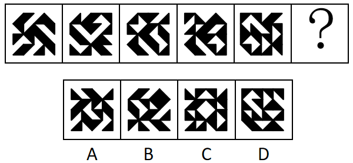
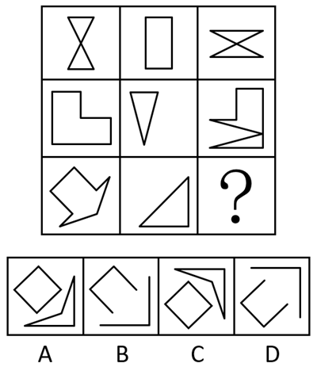
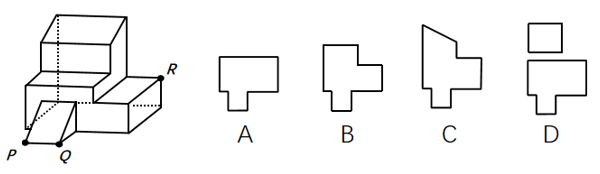

# 图形推理：题型、识别方法与近年真题核对

更新日期：2026-11-16。研究范围：2022—2026 年国考副省级、地市级图形推理；省联考材料仅作方法补充。

图形推理的基础体系可以继续沿用。结合既有教辅与近年真题，当前最需要加强的是四项能力：**选对观察单位，细化所数特征，按顺序组合操作，同时满足多项约束**。这些能力分别对应“看哪一部分”“数什么”“先做什么、再做什么”“哪些条件必须同时成立”。

## 一、资料范围与结论边界

本次阅读了仓库 2022—2026 年副省级、地市级共 10 卷的全部图形推理题干和解析，共 **100 个题位**。由于同一年两卷存在共题，按各年两卷的 `qid` 去重后，合计 **75 题**。

| 年份 | 两卷题位数 | 当年两卷按 qid 去重 |
|---|---:|---:|
| 2022 | 20 | 14 |
| 2023 | 20 | 15 |
| 2024 | 20 | 14 |
| 2025 | 20 | 17 |
| 2026 | 20 | 15 |
| 合计 | 100 | 75 |

其中，**12 道代表题查看并核对了原图**，另查看了 2025 年地市三点截面题的解析图。其余题以题干及解析阅读为主。这不等于独立重解全部 75 题，也不等于独立验证了每篇解析中的全部枚举过程。100 个题位不能作为 100 道独立试题计算频率；复合题也不适合强行归入互斥类别。

真题来源见[行测目录](../行测/)。本文重点引用[2025 年地市卷](../行测/2025国考行测（地市级）.md)、[2025 年副省卷](../行测/2025国考行测（副省级）.md)、[2026 年地市卷](../行测/2026国考行测（地市级）.md)、[2026 年副省卷](../行测/2026国考行测（副省级）.md)。题号沿用仓库主文档，跨来源核对时同时使用 `qid` 和选项内容。

仓库题库导出中的“官方解析”是解析字段名称，本文将其作为题库或机构解析使用，不据此认定为命题机关公布的答案。不同公开版本可能调整题号和选项顺序。

## 二、主要题型与解题切入点

下表是观察和推理的维度，同一道题可以同时使用多个维度。

| 维度 | 主要题型与定义 | 快速切入 | 适用限制 |
|---|---|---|---|
| 位置变化 | 元素或顶点的位置、朝向按规律变化，包括平移、旋转、翻转，内外分开移动，多元素分别移动 | 选有方向或不对称的锚点，记录路径、步长、方向和朝向；确定移动单位 | 整体旋转保持形状，顶点分别移动可能使图形变形。元素组成相同，也可能考面数、面积或连接关系 |
| 样式运算 | 元素的遍历；图形叠加、相减、求同、求异；按题目定义进行黑白或多状态运算 | 对齐位置，用完整行或列推导规则，再验证另一行或列 | 黑白运算不默认等于异或；“空”不一定等于“白”；复合操作必须明确顺序 |
| 属性 | 轴对称、中心对称、曲直、开闭；对称轴的数量、方向及其与点线面的关系 | 先检查显著属性，再切换至最大面、内部白区或独立组件 | 轴对称与中心对称可以同时成立；中心对称指绕某点旋转 180° 后重合。整体不对称不排除局部对称 |
| 数量 | 点、线、角、面、元素、连通部分、最少笔画；特殊类别数量、面积比例、数量之间的关系 | 优先选择被图形强调且能区分选项的指标；总数无区分时再细化 | 元素数、部分数、面数不同；直线与被交点分开的线段不同；计数口径必须始终一致 |
| 静态关系与功能标记 | 相离、相切、相交、包含；点接触、边接触；交点内外；点或箭头标记特定位置、方向、样式 | 先问标记指向什么，再检查公共边、端点、内外关系和相对位置 | 共边条数不等于所接白区个数；四条公共边可能只接触三个白区；标记不一定只是待计数的元素 |
| 空间 | 正方体、长方体及组合体的折叠与展开；三视图；截面；平面、立体拼合与旋转 | 折叠找特征面和公共边；视图列方向、颜色、高度及总数约束；截面追踪切平面；拼合先守恒后对接 | 相邻关系只是必要条件；投影不等于截面；体块数相等不保证能拼合；刚体旋转不能任意改成镜像 |

数量类还应细分观察对象。例如“点”可以是曲直交点、边框内部交点、边框上的交点、切点或端点；“面”可以考数量、形状、面积；“线”可以按直曲、横竖、平行关系或笔画进一步区分。[华图 2025 年发布的数量类整理](https://ah.huatu.com/2025/1010/3126070.html)可补充这一细分清单，但不能代替实际题目的统一计数规则。

### 识别提示的正确用法

“组成相同先看位置、相似先看样式、不同先看属性或数量”可以帮助提出候选方向，不能据此认定考点。

- 2026 年 `qid19526400` 的黑块组成相同，最终考的是围成的白色封闭区域数量。
- 2026 年 `qid19526294` 的黑三角形整体发生变形，分别追踪三个顶点却可以识别位置规律。
- 2025 年 `qid19283847` 整体数面无效，需要改看最大封闭面的对称性。

因此，整体、局部、负空间三个观察层级都应掌握。“负空间”在这里指实体或线条之间留下的白色区域。

## 三、提高识别速度的步骤

1. **先确定任务。** 是顺推、九宫格、分组，还是折叠、视图、截面、拼合？问的是可能还是不可能？选非题先标记提问方向。
2. **确定观察单位。** 选择整体轮廓、独立组件、顶点、黑白块、封闭白区或特殊面。利用选项差异寻找有区分力的特征。
3. **按线索提出少量候选规则。** 固定框架里的颜色变化可先试对应位置的运算；明确给定立体任务时，直接进入空间约束。
4. **用全部已知图验证。** 同一指标、同一计数口径、同一操作顺序应贯穿全题。九宫格至少验证两个完整行或列；分组规则必须覆盖组内全部图，并能区分另一组。
5. **必要时加入第二约束。** 单条件仍留下多个选项时，检查局部关系、颜色、总数、方向或组件属性。第二条件应有题面依据，不能临时为某一格另设规则。

这套过程的作用是减少无效搜索和重复尝试。具体题目的用时取决于题形和熟练程度，不据本次研究给出统一作答秒数或个人训练阈值。

## 四、关键方法、反例与边界

### 4.1 数量：先定义对象，再开始计数

以下概念应分别记录：

| 容易混淆的对象 | 应检查的问题 |
|---|---|
| 元素数与连通部分数 | 数的是几个小黑块，还是这些黑块连接成几部分？ |
| 面数与元素数 | 数的是闭合边界围成的区域，还是组成图形的基本元素？ |
| 直线数与线段数 | 交点是否把同一直线分成多个待计数线段？全题能否使用同一口径？ |
| 总交点与特殊交点 | 是否只数曲直交点、边框上的点、内部的点或切点？ |
| 公共边与相邻区域 | 多条公共边是否连接同一个白区？只在一个点相接是否满足题目关系？ |
| 面的形状与面积 | 题目判别的是形状，还是另有等面积、比例、全等要求？ |

优先利用格点、明确等分和给定结构判断面积关系，不凭透视图或印刷尺寸作任意精确测量。2026 年同形白区题的判别口径是与黑面形状相同的白面数量，不能额外推断这些区域等面积或全等。

### 4.2 样式与复合规则：明确状态、位置和顺序

黑白运算应从已知图推导。例如，在对应位置上观察“黑与黑得到什么”“黑与白得到什么”，而不是先套预设表。如果题目还包含空位置，应把空与白分开记录，直到题目证明可以等同处理。

对求同、求异、叠加等操作，先把图形放在统一位置，再判断保留哪些部分。复合题还要写清旋转或翻转发生在运算前还是运算后。例如 2026 年 `qid19526396` 使用：

$$
\text{第三图}=\text{将第一图与第二图的求异结果逆时针旋转 }90^\circ
$$

验证前两行后才能应用于第三行。只解释一行，或为了某个选项临时更换旋转方向，都不能算完成验证。

### 4.3 一笔画：连通条件不能省略

此处的一笔画是指沿图中每条边恰好走一次，可以重复经过顶点，不重复走边。先将实际相接的端点、交点视为顶点，将它们之间的线视为边。一个顶点连出的边数为奇数时，称为奇点。

设每个**含边的连通分量**有 $o_i$ 个奇点，则最少笔画数为：

$$
\text{最少笔画数}=\sum_i \max\left(1,\frac{o_i}{2}\right)
$$

一个连通分量有 0 个或 2 个奇点时可以一笔画；有 4 个奇点时至少两笔，依此类推。多个互不连通的部分分别计算，再相加。

两个不相连的圆没有奇点，仍需两笔；一个圆没有奇点，也不是零笔。汉字书写笔画与这一图论定义应分开。对于填充黑块，不能默认将任何形状任意简化成线图，须说明题目采用的观察对象和统一规则。

仓库[《国考66考点判断推理》](../教辅/行测/图形推理/huatu-国考66考点判断推理.txt)和[《图形推理10大考点》](../教辅/行测/图形推理/huatu-图形推理10大考点.txt)已经注明连通前提，应保留这一条件。2026 年发布的部分概览仍将公式简写为只看奇点数，使用时需要补全条件，见[辽宁华图图推概览](https://m.ln.huatu.com/2026/1013/2137792.html)。

### 4.4 折叠与展开：从面关系检查到图案方向

可按以下顺序核对：

1. 给面编号，优先找到有方向或不对称的特征面。
2. 用相对面关系初筛。在普通不透明凸正方体的外部三面直观图中，一对相对面不会同时可见。
3. 检查相邻面的公共边、公共顶点，以及图案相对于它们的位置。
4. 统一观察方向，核对箭头、端点、黑白块的朝向和连续性。

“这些面彼此相邻”不足以证明选项正确。面内图案可能转错方向，公共顶点也可能不一致。长方体还要区分尺寸不同的面；多个立方体组成的题目，需要分别建立各自的面对应关系。

这些基础方法在[《六面体相邻面排除法》](../教辅/行测/图形推理/huatu-六面体相邻面排除法.txt)和[《六面体必杀技》](../教辅/行测/图形推理/huatu-六面体必杀技.txt)中已有覆盖。近年应增加的实例，是彩色小方块组成的长方体展开图，以及两个立方体分别匹配展开图。

### 4.5 三视图：轮廓、可见颜色与总体数量联合检查

三视图是从不同方向作投影。解题时先统一前后、左右和上下方向，再将每个方向的轮廓、高度、可见颜色写成约束。

投影可能遮挡内部或后方体块，所以“某个方向看起来相同”不等于复原唯一。题干给出的体块总数、各色数量也是约束，不能读完视图后丢弃。

2026 年 `qid19526397` 给出俯视、左视及 15 白＋3 黑的总数。先根据颜色位置排除部分选项，再用总体数量区别剩余方案。机构解析对错误选项列举了多种复原；本文核对了题图和解析的推理方向，未另行独立枚举全部空间配置。

### 4.6 截面：同一平面与实际边界

截面是物体与一个平面的交集；视图是沿某个方向的投影。截面边界要落在物体实际表面上，切到棱的位置决定截面顶点。

**三点定平面需要三个点不共线。** 给定三个不共线点后，应沿这个确定的平面追踪各面的交线。对组合体可以先分析各部分，但各部分的截面必须来自**同一个平面**，再按真实位置组合。两个子体分别存在某种截形，不足以证明它们可以同时组合成选项。

仓库[《截面图降维思想》](../教辅/行测/图形推理/offcn-截面图降维思想.txt)中“过六个面：正六边形”的表述应补充为：**正方体截到六个面时可以得到六边形，特定位置才得到正六边形。**

一个直接反例是单位立方体 $[0,1]^3$ 与平面：

$$
x+y+z=1.2
$$

截面顶点依次为：

$$
(1,0.2,0),\ (1,0,0.2),\ (0.2,0,1),\ (0,0.2,1),\ (0,1,0.2),\ (0.2,1,0)
$$

六条边的长度交替为 $0.2\sqrt2$ 和 $0.8\sqrt2$。六个面均被截到，但截面不是正六边形。

“截面边数不超过面数”用于凸多面体时，有每个面至多贡献一条截面边的依据。对于凹体、空心体，应检查真实边界、孔洞以及截面是否由多个不连通部分组成，不能只拿外形的面数套用。仅凭边数也不能认定某个多边形一定可由给定立体截出。[华图截面整理](https://m.nx.huatu.com/2024/0730/1725473.html)中关于六条边以内图形的概括过宽，不能作为充分判据。

### 4.7 拼合：守恒初筛之后检查空间匹配

立体拼合先检查总体体积或小方块数、颜色数量是否守恒，再检查凹凸位置、接触面、各层轮廓以及旋转后的对应关系。题干给出前后两个直观图时，两者都要满足。

数量和颜色合适，只能保留候选，不能直接证明可拼。题目允许旋转时，也不能擅自镜像一个有手性差异的部件。2026 年 `qid19526428` 还采用“除哪项外”的提问方式，需确认被排除的是哪一个部件。

## 五、12 道已核对原图的代表题

下表保留原图链接，便于直接检查观察单位、局部关系和选项。答案字母沿用仓库版本。

| 年份、卷别、仓库题号；qid | 原图 | 规则与结果 | 需要补强的能力 |
|---|---|---|---|
| 2025 地市81；19283847 | [题图](../行测/图片/90-图片/题目图/193819d443fbf6f.png) | 整体数面不能区分，改看最大封闭面的轴对称性，选 D | 从整体切换至最大面 |
| 2025 地市85；19283859 | [题图](../行测/图片/90-图片/题目图/19381b61ea714a5.png)；[截面解析图](../行测/图片/90-图片/题目图/19381b6a1957bfe.png) | 经 P、Q、R 的同一平面截组合体，选 A | 三个不共线点定平面；追踪凹凸结构 |
| 2025 地市86／副省86；19283952 | [题图](../行测/图片/90-图片/题目图/1938250367ecfe7.png) | 4 黑＋8 白小正方体粘接成长方体，选择外表面展开图；核公共边处颜色，选 D | 不同尺寸面与颜色跨边连续性 |
| 2026 副省81；19526294 | [题图](../行测/图片/90-图片/题目图/19ad3b3b7e23ff1.png) | 三角形的两个外圈顶点、一个内圈顶点分别沿所在环逆时针移动，选 A | 追踪顶点，允许整体形状变化 |
| 2026 副省82／地市83；19526400 | [题图](../行测/图片/90-图片/题目图/19ad4cb8d0d0814.png) | 封闭白区数为 0、1、2、3、4，选 5 个的 D | 元素相同也可能考面数；观察负空间 |
| 2026 副省84／地市84；19526396 | [题图](../行测/图片/90-图片/题目图/19ad4d968fe03fe.png) | 每行先求异，再逆时针旋转 90°，选 C | 复合操作的顺序及完整验证 |
| 2026 副省85；19526311 | [题图](../行测/图片/90-图片/题目图/19ad3c3e52b9a22.png) | 总笔画为 3，还要将 1 笔、2 笔对应到中心对称、轴对称的组件，选 B | 属性与数量绑定，不能只记总数 |
| 2026 副省86／地市85；19526397 | [题图](../行测/图片/90-图片/题目图/19ad4d2221d7e6b.png) | 俯视、左视与 15 白＋3 黑联合约束；颜色位置初筛后用总数区分，选 B | 投影轮廓之外的总体数量约束 |
| 2026 副省87；19526329 | [立体图](../行测/图片/90-图片/题目图/19ad3d242ab3ff9.png)；[展开图](../行测/图片/90-图片/题目图/19ad3d364a5e3fa.png) | 两正方体组合成长方体，以 T 形面为锚核公共边，符合①③；仓库选 D | 双物体匹配，面内方向核验 |
| 2026 副省88；19526428 | [题图](../行测/图片/90-图片/题目图/19ad4e04709e585.png) | 12 白＋3 灰组合体，A、C、D 旋转拼合，排除 B | 选非提问；守恒与形状匹配同时满足 |
| 2026 副省89／地市89；19526253 | [题图](../行测/图片/90-图片/题目图/19ad3b9b21177ec.png) | 每图均 1 黑面、4 白面；①②④有 2 个白面与黑面形状相同，③⑤⑥有 1 个，选 B | 按形状筛选后计数，不推断等面积 |
| 2026 地市90；19526305 | [题图](../行测/图片/90-图片/题目图/19ad3b9a6b95d24.png) | ①④⑤交点在白圆片外，②③⑥交点在白圆片内，选 A | 交点位置与数量分别检查 |

2026 年双正方体题的[华图公开版本](https://m.zj.huatu.com/2025/1130/1962883.html)列为第 88 题、答案 A，仓库副省卷列为第 87 题、答案 D；两者实际均选择①③。跨来源比较应核对选项内容，不能只比较字母。

### 例一：组成相同，改看封闭白区

黑块本身容易吸引注意，但真正变化的是它们围成的封闭白区数量。先确认计数对象，再逐图得到 0、1、2、3、4，最后在选项中找 5。这个例子适合与普通平移题并列，检查是否把识别提示误当成唯一判据。

### 例二：先运算，再旋转

每行前两图先在对应位置求异，再将结果逆时针旋转 90°。第二行提供独立验证，第三行按同样过程得到 C。讲解应保留中间结果和旋转方向，避免只写“求异＋旋转”而省略操作对象和顺序。

### 例三：经过指定三点的截面

P、Q、R 不共线，确定一个切平面。追踪该平面与整个组合体的交线得到 A，可结合[解析图](../行测/图片/90-图片/题目图/19381b6a1957bfe.png)核对。不能分别为上下或前后部件挑选不同截面后拼成选项。

## 六、仓库教辅已经覆盖什么，还应补什么

| 既有资料 | 已有价值 | 应补充或修正的内容 |
|---|---|---|
| [《国考66考点判断推理》](../教辅/行测/图形推理/huatu-国考66考点判断推理.txt) | 属性、位置、样式、数量和空间基础；一笔画连通条件 | 以近期真题补观察单位切换、复合操作和空间联合约束 |
| [《陕西职测考前30分判断推理》](../教辅/行测/图形推理/huatu-陕西职测考前30分判断推理.txt) | 快速复习框架与基础例题 | 明确材料适用的考试范围；补国考 2025—2026 对应变式 |
| [《六面体相邻面排除法》](../教辅/行测/图形推理/huatu-六面体相邻面排除法.txt)、[《六面体必杀技》](../教辅/行测/图形推理/huatu-六面体必杀技.txt) | 特征面、箭头、公共点和公共边方法 | 增加不同尺寸面、彩色小方块、双正方体匹配；说明相邻关系仅是初步条件 |
| [《截面图降维思想》](../教辅/行测/图形推理/offcn-截面图降维思想.txt) | 将截面边、点追溯至立体面、棱；分拆组合体分析 | 六面截面不必为正六边形；补同一切平面、凸性、孔洞及断开部分的条件 |
| [《图形推理看图感定考点》](../教辅/行测/图形推理/huatu-图形推理看图感定考点.txt) | 根据图形线索提出候选方向 | 配反例，防止将提示词当充分判据 |
| [《图形推理10大考点》](../教辅/行测/图形推理/huatu-图形推理10大考点.txt) | 基础特征清单，含连通图前提 | 将总数细化到局部、类型和关系；不把历史考情表当当前频率 |

仓库中的部分粉笔、中公、华图出版物文件是出版社或书店的介绍、目录。书名或页面标有 2023、2025，并不意味着已有相应新版教材全文；不能据这些目录声称完成新版教材正文核对。

后续补充宜优先围绕以下难点组织：

- **观察单位切换：**整体、最大或最小面、内部白区、外轮廓、独立组件、顶点。
- **数量与关系细化：**总面数转为同形面数；总交点转为内外交点；黑块个数、部分数、接触区域数分别记录。
- **规则复合：**黑、白、空三状态运算；求异后翻转或旋转；对称性与笔画数量的对应关系。
- **空间约束：**相邻面之外的方向；不同尺寸面的展开；多个立方体的分别匹配；颜色、投影与总数联合复原；指定三点的截面。

每道补充题应保留年份、卷别、仓库题号、`qid`、原图、答案内容、观察单位、完整规则、适用条件和一个易错点。同一 `qid` 的两卷共题标为同一题；角度、箭头和公式图片应保留，避免纯文本丢失关键条件。

## 七、网络更新带来的有效补充

网络材料用于补充例题、细分指标和交叉核对。发布日期较新并不自动意味着表述完整，应继续检查数学条件和真实题图。

| 来源 | 日期或适用时期 | 本文采用的信息 | 使用边界 |
|---|---|---|---|
| [华图：2026 国考判断推理考后题例](https://m.zj.huatu.com/2025/1130/1962883.html) | 2025-11-30 发布，涉及 2026 国考 | 双正方体展开图的①③结论，与仓库对照 | 采用具体题例，不采用笼统的难度评价；注意选项排序不同 |
| [华图：图形推理数量类整理](https://ah.huatu.com/2025/1010/3126070.html) | 2025-10-10 发布 | 特殊交点、特殊线、面的形状和面积等细分指标 | 属于备考方法整理，不是考后题型频率统计 |
| [华图：2026 省联考图形推理例题分析](https://m.huatu.com/2026/0314/2854058.html) | 2026-03-14 发布 | 线数与面数关系；以两段式形式考立体拼合 | 只作省考补充，不据此推导国考占比 |
| [粉笔：国考考情分析兼备考指导—判断篇](https://hera-webapp.fenbi.com/api/article/detail?app=gwy&id=452447371283456) | 内容覆盖 2020—2024 | 白区对称、黑白空运算、长方体展开等历史变式 | 文首判断题总量描述属于旧时段，不能直接当作当前结构 |
| [辽宁华图：图推考点概览](https://m.ln.huatu.com/2026/1013/2137792.html) | 2026-10-13 发布 | 对当前方法概览进行条件核对 | 一笔画简式须补连通条件；“复合”与其他维度交叉，未采用文中无明确样本口径的占比 |
| [华图：截面图整理](https://m.nx.huatu.com/2024/0730/1725473.html) | 2024-07-30 发布 | 作为基本体和组合体截面资料的对照 | 不采用仅凭边数认定任意形状可截出的概括 |

本文可以支持题型梳理、代表题讲解和材料补缺。对未来命题概率、统一作答时间和个人薄弱项，不作超出样本与核验范围的推断。
